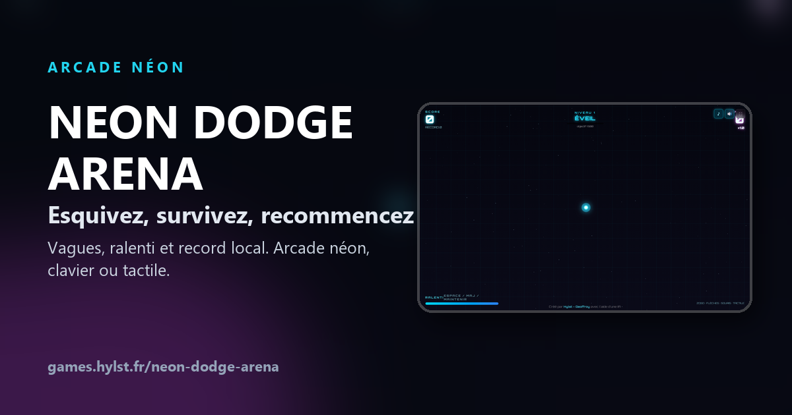

# Neon Dodge Arena

**Esquivez les projectiles, survivez aux vagues et battez votre record.**

Neon Dodge Arena est une arène d'esquive néon. Déplacez le vaisseau au clavier, à la souris ou au doigt, survivez aux vagues de projectiles et gagnez des points en restant en vie. Le mode ralenti se déclenche avec Espace, Maj ou un maintien tactile ; les niveaux s'enchaînent avec des objectifs croissants, des motifs de tir plus denses et des combos. Le record local est conservé dans le navigateur, le son et la musique sont synthétisés, et le plein écran est disponible.

Joue ici : [games.hylst.fr/neon-dodge-arena/](https://games.hylst.fr/neon-dodge-arena/)



## Fonctionnalités

- Arène d'esquive avec vaisseau, projectiles, vagues et combos.
- Clavier, souris et tactile, mode ralenti et plein écran.
- Niveaux progressifs avec objectifs et motifs de tir.
- Record local dans `localStorage` (`neonDodgeHighScore`), aucune donnée nominative.
- Son et musique synthétisés avec Web Audio.
- Police Orbitron auto-hébergée, licence incluse.

## Technique

- React 19, TypeScript, Vite 7 et Tailwind CSS 4.
- Build en un fichier `index.html` avec `fonts/` local.
- Aucune requête réseau pendant la partie, aucun compte, aucun cookie.

```bash
npm ci
npm run build
```

Le build sort dans `dist/`. Il se sert sous `/neon-dodge-arena/`.

## Structure

```
src/App.tsx   arène, vaisseau, vagues, score et record
src/levels.ts niveaux et objectifs
src/audio.ts  musique et effets Web Audio
public/fonts/ Orbitron et licences
```

## Licence

AGPL-3.0-or-later. Voir `LICENSE`.

Jeu créé par Geoffroy (Hylst) avec l'aide d'une IA.
